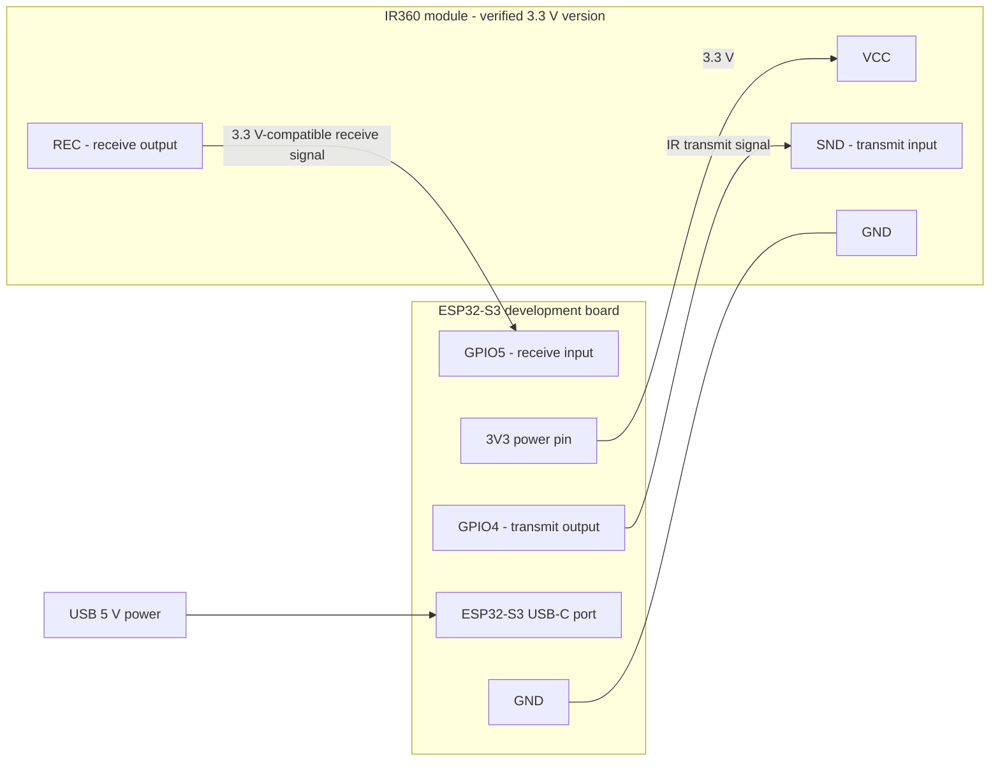
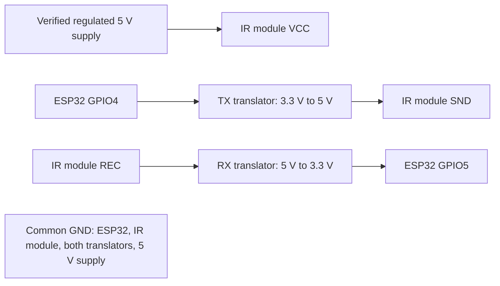

# ESP32-S3 / IR360 Enclosure Prototype

Adjustable, unverified-fit prototype for an Espressif ESP32-S3-DevKitC-1
and the Jessinie 38 kHz IR transmitter/receiver linked below.

## Preview


The base and lid are shown apart to expose the board retainers and IR opening.
Both electronics models are non-print references; hardware fit remains unverified.

## IR Module Reference

| Recreated model beneath the lid | Original module reference photo |
| --- | --- |
|  |  |

The supplied photo guided the component layout. PCB dimensions, LED tilt,
and package sizes are estimates, not measurements from the photo. See
[Recreated IR Module Reference](#recreated-ir-module-reference) for assumptions
and the revised edge-clamp mount that clears the modeled LED bodies.

## Files

- [Editable SolidCraft design](esp32_s3_ir360_prototype.solidcraft)
- [Base STL](base.stl)
- [ESP32 retaining bar STL, print two](esp_retainer.stl)
- [Lid with IR through-window STL](lid_ir_deck.stl)
- [IR keeper plate STL, print two](ir_keeper.stl)
- [STEP, enclosure and retainers in print layout](esp32_s3_ir360_prototype.step)
- [Preview](preview.png)
- [Assembly with ESP32 reference, editable JSON](esp32_s3_ir360_with_reference.json)
- [Reference assembly preview](reference_preview.png)
- [Recreated IR module close-up](ir_reference_preview.png)
- [Recreated IR module STEP, reference only](ir_module_reference.step)
- [Downloaded YD-ESP32-S3 reference STEP](YD-ESP32-S3.step)
- [Reference repository licence](YD-ESP32-S3-LICENSE.txt)

## Parts List

Quantities below are for one enclosure, with no spares. Fastener lengths are
measured from beneath the head. Confirm fit with your filament, actual PCB,
and fasteners before ordering a large batch.

### Printed Parts

| Quantity | Part | File |
| --- | --- | --- |
| 1 | Base | [base.stl](base.stl) |
| 1 | Lid, already oriented flat for printing | [lid_ir_deck.stl](lid_ir_deck.stl) |
| 2 | ESP32 retaining bars | [esp_retainer.stl](esp_retainer.stl) |
| 2 | IR PCB keeper plates | [ir_keeper.stl](ir_keeper.stl) |

Six printed pieces total. PETG, 0.2 mm layers, and four perimeters are the
suggested starting settings. Do not print either electronics reference model.

### Screws And Hardware

| Quantity | Fastener | Location and requirement |
| --- | --- | --- |
| 4 | M2.5 x 8 mm plastic-thread-forming screws | ESP32 retaining bars into base bosses; 2 mm bar leaves about 6 mm engagement in the 8 mm-deep pilots |
| 4 | M2.5 x 10 mm plastic-thread-forming screws | Lid into the four base corner posts; 2 mm lid leaves about 8 mm engagement in the 12 mm-deep pilots |
| 4 | M2.5 x 10 mm machine screws, low-profile heads | IR keeper plates; head height no more than 1.5 mm; insert from inside with nuts outside |
| 4 | M2.5 hex nuts, approximately 2 mm thick | Outside the lid, on the IR keeper bolts |
| 4 | M2.5 flat washers, approximately 0.5 mm thick, outside diameter no more than 6 mm | One under each external IR keeper nut |

There are 12 screws/bolts total, plus four nuts and four washers. The two
M2.5 x 10 mm rows are different fastener types: machine screws need nuts;
plastic-thread-forming screws bite directly into the printed 2.1 mm pilots.
Do not substitute sharp wood screws or force oversized screws into the posts.
No heat-set inserts, PCB mounting-hole screws, or adhesive pads are required.

The IR bolt stack is approximately 2 mm keeper + 1.6 mm spacer + 2 mm lid +
0.5 mm washer + 2 mm nut = 8.1 mm, leaving about 1.9 mm of a 10 mm bolt beyond
the nut. Check your real hardware. The keeper bolts pass outside the PCB,
not through its corner holes. Keep nuts and protruding threads on the outside;
low screw heads on the inside preserve clearance above the ESP32.

### Electronics And Wiring

| Quantity | Item | Notes |
| --- | --- | --- |
| 1 | ESP32-S3 N16R8 dual-USB-C development board | Your actual board, with fitted pin headers; reference CAD is only a close match |
| 1 | 360-degree 38 kHz IR transmitter/receiver module | Four-pin interface labeled VCC, REC, SND, GND; verify electrical ratings below |
| 1 | USB-C data/power cable | Slim plug; the modeled sockets are recessed, so verify reach |
| 1 | Regulated USB 5 V supply, typically 1 A or greater | Supply rating is available capacity, not permission to exceed the board regulator rating |
| 4 | Short insulated signal/power leads, typically 26-28 AWG | VCC, GND, REC, SND; select wire gauge after checking module current |
| 1 set | Suitable 2.54 mm female connectors or soldered harness | Low-profile/right-angle connectors may be needed; check lid and LED clearance |
| As needed | Heat-shrink tubing and strain relief | Insulate every splice and keep wiring away from keeper screws and optics |
| 1 | 100 nF ceramic capacitor, rated at least 10 V | Recommended across module VCC/GND, close to its header, if not already fitted adequately |
| 1 | 10 uF capacitor, rated at least 10 V | Recommended local bulk decoupling; observe polarity if electrolytic |
| Conditional: 2 | SN74LVC1T45 level-shifter breakouts, or equivalent direction-controlled 3.3 V/5 V translators | Only for the verified 5 V module option; one TX channel and one RX channel |
| Conditional: 4 | 100 nF ceramic bypass capacitors | For the two translators, one per supply pin, unless already on their breakouts |

A multimeter, a matching screwdriver/hex key, and a small nut driver or pliers
are needed for assembly. Use a soldering iron only if the selected harness or
translator requires soldering. Electronics, connectors, capacitors, and extra
translator boards have no dedicated new mounting positions in the CAD; check
their physical clearance and insulate them before closing the enclosure.

## Wiring Diagram

**Provisional wiring, not an electrically tested design.** The supplied photos
confirm the VCC / REC / SND / GND labels, but neither the photo nor the accessible
seller information establishes this exact module's supply range, current draw,
SND input threshold/polarity, or REC output type. Confirm those with the seller's
schematic/datasheet or a controlled bench test before connecting it. ESP32-S3
GPIO is 3.3 V logic, not 5 V tolerant. Do not infer electrical compatibility
from the 3D model or from another similar-looking module.

### Option A: Verified 3.3 V Module

Use this option only if the actual module is rated for a 3.3 V supply, accepts
3.3 V SND signaling, and its REC output is compatible with ESP32 3.3 V input
thresholds and voltage limits. Its peak current must also fit the development
board's remaining 3.3 V regulator capacity while Wi-Fi is transmitting.



| IR module label | ESP32 connection | Direction / purpose |
| --- | --- | --- |
| VCC | 3V3 | Power, only after verifying the module's 3.3 V rating and current budget |
| REC | GPIO5 | Module output to ESP32 input |
| SND | GPIO4 | ESP32 output to module input |
| GND | GND | Common ground |

Connect the 100 nF and 10 uF capacitors in parallel between the module's VCC
and GND, near the module. On a polarized capacitor, positive goes to VCC and
negative to GND. These are supply bypass capacitors, not series components.

Follow the silk-screen labels on the real boards, not the apparent top-to-bottom
order in a photograph. GPIO4/GPIO5 mean GPIO numbers, not the fourth/fifth pin
along a header. Verify the clone's pinout. These example pins avoid the native
USB GPIO19/GPIO20 and the N16R8 module's reserved flash/PSRAM connections.
Do not connect to a pin merely labeled TX/RX expecting it to be GPIO4/GPIO5.

### Option B: Verified 5 V Module

If the actual module requires 5 V, do not simply move VCC to 5 V and leave
REC directly connected to the ESP32. Use suitable level translation in both
directions unless the module's documented interface explicitly allows otherwise.
The following is a conditional topology, not confirmation that this module is
5 V-rated. Both logic levels and the module supply rating must be verified first.



For two SN74LVC1T45 breakouts, wire by the breakout's signal labels and its
datasheet, not by an assumed package pin order:

| Translator | A port | B port | VCCA | VCCB | DIR |
| --- | --- | --- | --- | --- | --- |
| TX | ESP32 GPIO4 | Module SND | ESP32 3V3 | Verified module 5 V supply | Tie to VCCA: A to B |
| RX | ESP32 GPIO5 | Module REC | ESP32 3V3 | Verified module 5 V supply | Tie to GND: B to A |

Connect both translator grounds to the common ground. Bypass each VCCA and
VCCB to ground with 100 nF at the device, unless fitted on the breakout.
Supply both sides as specified by the translator datasheet; never leave DIR
floating. A generic I2C-only MOSFET shifter is not automatically a suitable
replacement for a driven IR transmit signal. An ordinary series resistor
alone does not make a 5 V receive signal safe for ESP32 GPIO.

For this topology, power the ESP32 from USB and the IR module from a separately
verified, current-rated 5 V rail, with grounds connected. Do not connect an
external 5 V source to the ESP32 5V pin while USB is also attached unless that
exact development board documents safe power OR-ing. Do not tie a 5 V rail to
3V3. The extra translator boards and harness still require a physical fit check.

### Before Powering

1. Confirm the module supply rating, input/output voltage levels, pin labels,
   and peak current. Do not connect REC to the ESP32 until its voltage range
   is known. If testing the module separately, use a current-limited supply
   within its confirmed rating; check both idle and active signal levels.
2. Disconnect power while wiring. Check VCC/GND polarity, common ground,
   connector orientation, and absence of shorts or exposed conductors.
3. Configure GPIO4 as the IR transmit output and GPIO5 as the receive input
   in firmware. Verify SND's inactive polarity before enabling transmission.
   If SND is a raw LED-driver input, generate the required modulated carrier
   (typically 38 kHz for this listing); the listing title alone does not prove
   that the board generates a carrier internally. These are not UART TX/RX links.
4. Test reception and short transmit bursts with the lid open. Confirm that
   the power rail stays stable, nothing overheats, and the LEDs are not left
   continuously energized. Then check cable, screw-head, and wire clearance
   before closing the enclosure. There is no hardware-verified firmware in
   this repository yet.

## ESP32 Reference Assembly

Both the native SolidCraft design and the reference JSON assembly now include
the downloaded YD-ESP32-S3 model inside the base. The lid remains beside the
base for visibility. The revised base includes taller PCB supports, four
retainer screw bosses, side guides, and end stops. Two removable bars secure
the PCB edges without requiring mounting holes in the board. They are shown
installed in the editable assembly and laid out separately in the STEP export.
Two additional underside keeper plates now secure the IR PCB at its outer
edges; its original corner mounting holes are not used by the enclosure.
The imported component is named ESP32_S3_REFERENCE_NOT_FOR_PRINT. The recreated
IR component is named IR360_REFERENCE_ESTIMATED_NOT_FOR_PRINT. Exclude both
from any print export. Open the reference JSON as a SolidCraft design, not as
a command script.

This is an approximate dual-USB-C DevKitC-clone reference, not a confirmed
model of the purple ESP32-S3 N16R8 board shown in the user's photo. Its main
PCB measures 57.15 x 27.94 x 1.02 mm including modeled surface details; the
antenna extends beyond that PCB. Do not substitute these measurements for
measurements of the actual board. The STEP includes fitted pin headers,
whereas the photo shows the headers separately.

Placement is a 90-degree world-X rotation followed by a 180-degree world-Z
rotation and translation [0, 0, 11.01]. The PCB underside is Z = 10 mm,
supported directly by the revised Z = 10 mm support pads. Reference
bounds are approximately [-29.2088, -13.975, 2.31] to
[34.815, 13.975, 14.22]. The modeled header pins clear the 2 mm floor by
0.31 mm; highest modeled components clear the lid underside by 5.78 mm.
These are geometric reference clearances, not manufacturing tolerances or
a complete interference assessment with the estimated IR reference and wiring.

Both USB-C sockets face the negative-X access opening. Their fronts are
approximately 9.79 mm behind the outside wall, so actual cable plug reach
must be checked. The reference has not been slid into the wall. A future
USB-access revision may need to move the board or recess the wall.

The imported STEP has one open-body warning and several small-detail
face-wrapping warnings. There are no failed timeline features, but this
third-party import is for visual reference rather than precision collision
or mass calculations. The PCB volume is preserved through the rigid moves
(1555.390290 mm^3). The revised Base measures 23130.812933 mm^3;
the LED-clearance Lid measures 6395.018624 mm^3. Each ESP32 retainer measures
703.374005 mm^3 and each IR keeper 385.374005 mm^3. The exact interference check against the detailed imported
electronics timed out; the clearance statements here are based on measured
reference bounds, not a completed all-surfaces collision check.

## Header Clearance And Mechanical Retention

The previous pads stopped at Z = 8 mm, leaving a 2 mm unsupported gap below
the reference PCB. They now reach Z = 10 mm. Fitted reference header pins end
at Z = 2.31 mm, clearing the 2 mm floor by 0.31 mm. Longer actual pins will
require a further height/USB-clearance revision; do not force them onto the floor.

Print two copies of esp_retainer.stl. Each bar is 52 x 7 x 2 mm and has two
2.8 mm clearance holes on 46 mm centers. Four matching base bosses accept
plastic-thread-forming M2.5 x 8 mm screws in 2.1 mm pilots, 8 mm deep.
The screws go into the printed bosses, not the PCB. Bar undersides nominally
contact the PCB top at Z = 11.02 mm; tighten gently and stop if the PCB bends.

The retainers overlap the outermost 0.52 mm of the reference PCB edges.
Their inner edges are at Y = +/-13.45 mm, outside the modeled header pins
(outer pin edge +/-13.025 mm), leaving 0.425 mm lateral clearance. Check
both edges on the actual board for components, solder, and traces before
tightening. Do not clamp components or solder joints. The imported model
is not a verified model of the user's board revision.

Four side guides provide 0.28 mm nominal clearance per side. Four end stops
provide 0.25 mm nominal clearance at the main PCB ends and sit outside the
reference USB shells and antenna. Together the guides and stops limit X/Y
movement; the bars prevent lifting. No adhesive or PCB mounting holes are
required. The bars are separate from the lid, so the lid's optical opening
stays clear and the ESP32 remains retained when the lid is removed.

The reference is 27.94 mm wide with a 57.15 mm main PCB. Measure your actual
board before printing: ESP_PCB_half_L, ESP_PCB_half_W, ESP_PCB_T,
ESP_side_gap, and ESP_end_gap encode this fit. They are fixed documented
defaults, not validated adjustable ranges. Changing them requires rechecking
header, component, retainer-hole, wall, and USB clearances.

Model by David Scambell, originally published at
[GrabCAD](https://grabcad.com/library/yd-esp32-s3-1), downloaded from
[shkuznetsov/YD-ESP32-S3](https://github.com/shkuznetsov/YD-ESP32-S3) at commit
bb410449c3d5ee20096ff273d6c1081c5dd6228f. The repository publishes an MIT
licence with a manufacturer-licensing caveat and credits the original model
author. Its licence is retained alongside the unmodified STEP.

Source STEP SHA-256:
EDC0685479A0C1A91ABD1ADF4516EC2784258A58095663B3F4272A125D5CF624.

## Recreated IR Module Reference

No usable CAD model was found for the exact IR_Rec_Send_V1.1 / 303IRRECSE1
markings visible in the supplied photos. A simplified 38-body visual reference
was recreated from their component layout. It includes a blue rounded PCB,
four mounting holes, four outward-tilted IR LEDs with rounded lenses and leads,
a black receiver package, a four-pin header, and simplified component blocks.
It is included in both editable assembly formats, not the printable STLs or
the enclosure-only STEP.

The photos do not establish an accurate physical scale. The reference keeps
the previous estimated 30 x 20 mm PCB and 24 x 14 mm hole pitch, rather than
claiming new measured dimensions. Assumptions are:

| Reference item | Assumed value |
| --- | --- |
| PCB thickness / corner radius | 1.6 / 1.5 mm |
| Mounting-hole diameter | 3.2 mm |
| IR LED diameter / barrel length | 5 / 4.5 mm |
| LED center offsets from PCB center | +/-8 mm X, +/-6 mm Y |
| LED outward tilt | 25 degrees, diagonally away from center |
| Receiver body | 4 x 5 x 3.5 mm, rounded lens on top |
| Header | Four pins, 2.54 mm pitch, upright as photographed |

The PCB top is flush with the displayed lid underside at Z = 0, centered at
X = lid_X (92 mm by default). The reference envelope is approximately
[77, -10.0838, -2.6] to [107, 10.0838, 8.5034]. To place it over the base with
the lid assembled, translate it [-lid_X, 0, case_H], just like the lid.
Its lowest modeled pin is then Z = 17.4 mm and its highest lens Z = 28.5034 mm.
The standalone reference STEP retains these display-layout coordinates.

The LED-base interference with the old lid mounting fingers has been corrected
by removing those fingers. Four narrow supports now contact only the outermost
0.75 mm of the PCB's short end edges; two underside keeper plates retain it.
Fastener holes are outside the PCB, at X = +/-21.5 and Y = +/-6.5 relative
to the module center, rather than at the PCB's corner holes. The LEDs were not
shrunk, moved, or cut to make them fit. All 38 IR reference bodies retain their
previous volumes and positions. The LED body envelopes clear both the support
and keeper inner edges by 2.166 mm in X; they also remain inside the 36 x 26 mm
opening in Y. The header and receiver clear the relocated supports as well.
These checks apply to the estimated reference, not a measurement of actual
hardware. Verify real component positions and PCB edge clearance before printing.

Print two copies of ir_keeper.stl. Each keeper is 10.25 x 20 x 2 mm, with two
2.8 mm holes on 13 mm centers. The lid's 1.6 mm underside spacer bosses match
the assumed PCB thickness and prevent overtightening the keepers onto it.
Use four M2.5 x 10 mm through-bolts, washers, and nuts; insert the bolts from
below the keeper plates and put the nuts outside the lid. Use low-profile
heads no taller than 1.5 mm and check the actual stack and thread engagement.
Do not install long bolt tips pointing inward toward the ESP32. In the assembled
reference, keeper undersides are Z = 16.4 mm, 2.18 mm above the highest modeled
ESP32 component; a 1.5 mm head leaves 0.68 mm by vertical envelope comparison.
Fasteners themselves are not modeled and real wiring/board clearance is unverified.
Tighten only until secure; do not bend the PCB or trap components or solder joints.

The rounded LED/receiver lenses are separate overlapping reference solids,
not watertight fused electronic packages. Leads are simplified and PCB
lead-through holes, tracks, silkscreen, solder fillets, and fine package detail
are omitted. Do not use summed reference-body volume for physical mass or
treat this visual reconstruction as a certified manufacturing model.

The PCB sketch is fully constrained. Corner rounding is authored before
placement so that changing case_L does not invalidate its edge references.
Sequential walks between the default and upper endpoints of case_L = 78..82,
IR_pitch_X = 24..26, and IR_pitch_Y = 14..16 rebuilt without errors and were
returned to defaults. The PCB stays at 905.444046 mm^3 (analytic 905.437880);
its X center moves from 92 to 96 when the case length grows by 4 mm.
New IR timeline features have no errors or warnings. Primitive measurements
agree with independent formulas within 0.02 percent, including tilted LED
cylinders. The base and IR reference are unchanged; only the lid mount and
its new keeper parts changed in the LED-clearance revision. No expensive full interference
check against the detailed ESP32 import was attempted.

## Dimensions And Assumptions

All dimensions are millimetres.

| Item | Value | Status |
| --- | --- | --- |
| Base outside | 78 x 52 x 20 | Modeled and measured |
| Wall / floor / lid plate | 2 | Modeled |
| Exterior corner radius | 4 | Modeled |
| Closed case height, excluding IR deck | 22 | Derived |
| Maximum plastic height when assembled | 22 | Derived; IR optics protrude through the opening |
| ESP32 PCB envelope | Approximately 62.8 x 25.4 | Nominal assumption; verify actual revision |
| ESP32 support tops | Z = 10 inside base | Four PCB underside supports |
| ESP32 retention | Two removable 52 x 7 x 2 bars | Four M2.5 x 8 screws into printed bosses; no PCB holes |
| USB access, negative-X end | 26 wide x 8 high; Z = 7 to 15 | Cable and connector fit unverified |
| IR PCB | 30 x 20 | ESTIMATED, not supplied by seller |
| IR hole spacing | 24 x 14 | ESTIMATED, not supplied by seller |
| IR hole diameter | Approximately 3.2 | ESTIMATED; represented in the reference PCB |
| IR mounting | Outer PCB edges clamped beneath lid | Four 0.75 mm overlaps and two underside keepers; original PCB holes unused |
| IR external fastener pitch | 43 x 13 | Four M2.5 through-bolts, outside PCB and LED bodies |
| IR optical window envelope | 36 x 26 | Through-cut except for four short outer-edge support lips |

The listing photographs show four emitters, a receiver, and four corner
mounting holes, but contain no mechanical dimensions. Its linked PDF could
not be extracted. No dimensionally verified IR model or full interference
simulation was used. Approximate ESP32 and photo-recreated IR references are
included in the editable assemblies as described above. This is not a
guaranteed-fit enclosure.

The corrected lid has a real through-window: the former solid deck, raised
guard, raised mounting posts, and LED-clipping corner fingers have been removed.
Mount the IR PCB beneath the four outer-edge lips with its components facing
out through the opening, then clamp it from below using the two keeper plates.
The board is inside the case while the LEDs and receiver protrude through the
window. Verify their clearance from the edge supports and 2 mm lid thickness, along
with clearance to the ESP32 and wiring below. Exact component positions and
heights are not verified, so unobstructed optical coverage must be checked
with the actual module. The case is not waterproof, dustproof, or certified
for unattended installation.

## Assembly And Printing

1. Check actual IR PCB dimensions, mounting-hole pitch and diameter, header
   position, and component heights before committing to a full print.
2. Print the base, lid, two ESP32 retaining bars, and two IR keeper plates.
   The lid STL is already flipped with its flat outside face on Z = 0 and
   the underside spacer bosses pointing up; do not flip that STL again.
   Other STLs also have their flat print faces at Z = 0. Use the slicer's
   arrange/center command to remove the saved XY layout offsets.
   PETG, 0.2 mm layers, and four perimeters are reasonable starting settings.
   Check the 26 mm USB bridge in the slicer; local supports may be needed.
3. Orient the ESP32 length along X with both USB connectors toward negative X.
   Seat the PCB on the four Z = 10 mm supports between the side guides and end
   stops. Check that supports do not contact underside components and that
   pin tails clear the floor. Fit both retaining bars over the outer PCB edges
   and secure them with four plastic-thread-forming M2.5 x 8 mm screws.
   Tighten gently without bending the PCB. Check the pin/solder clearances
   described above. Retention is mechanical; foam tape is no longer required.
4. Keep the IR wiring inside the case. The former separate wiring slot is
   absorbed into the larger optical opening. Check header and wire clearance.
5. Mount the IR PCB against the lid's four outer-edge lips, with LEDs and
   receiver facing outward. Fit the two keeper plates beneath the PCB ends.
   The board's original mounting holes stay unused. Secure the keepers with
   four M2.5 x 10 mm through-bolts inserted from below, washers, and nuts on
   the outside of the lid. Use heads no taller than 1.5 mm; check engagement,
   electronics clearance, and bare PCB edge contact before tightening gently.
   Confirm the actual LEDs and receiver have an unobstructed optical path.
6. Close the lid with four suitable plastic-thread-forming M2.5 x 10 screws.
   Lid clearance holes are 2.8 mm and base pilots are 2.1 mm x 12 mm deep.
   Check a pilot-hole coupon with your material and screws; do not overtighten.

The native/JSON designs show the retaining bars installed. The STEP export
shows them in print layout: translate the north bar [0, -18.55, 11.02] and the
south bar [0, 18.55, 11.02] to assemble them. The single bar STL prints twice;
the second bar is the same part turned 180 degrees around Z.

The STEP lid is also flipped for printing, like its STL. To assemble that
STEP lid, rotate it 180 degrees around world X and translate [-92, 0, 22].
The STEP IR keepers sit at Y = 52, Z = 0; translate both [0, -52, 16.4] to
assemble them. Print the single keeper STL twice; the second is the same part
turned 180 degrees around Z. Native/JSON keepers are already installed under
the displayed lid, and should move with the lid/IR module when assembling it.

In CAD, assemble the lid by translating it [-92, 0, 20] from the default
print layout. The general translation is [-lid_X, 0, case_H]. No locating lip
is provided; the four screws align the lid.

## Parameters And Checks

Favourite driving parameters have these tested endpoint ranges:

| Parameter | Default | Tested range |
| --- | --- | --- |
| case_L | 78 | 78 to 82 |
| IR_pitch_X | 24 | 24 to 26 |
| IR_pitch_Y | 14 | 14 to 16 |

Other driving dimensions are documented as fixed. IR_PCB_L and IR_PCB_W are
estimates that drive the recreated PCB and its outer-edge clamps, not the window.
IR_window_L = 36 and IR_window_W = 26 are fixed dimensions. IR_tab_W is a
legacy input to the earlier fingers, removed by the final clearance feature.
Changing IR mounting pitches now moves only reference-PCB holes and the
superseded upstream fingers; the final edge clamps do not use those holes.
IR_edge_overlap = 0.75 and the keeper/spacer dimensions are fixed documented
defaults, not tested adjustable ranges. Larger changes require a new clearance
and geometry check. Earlier deck/finger features remain in the timeline, but
the final named removal and outer-edge mount features replace their geometry.

The original enclosure and corrected lid endpoint checks are recorded below.
The imported ESP32 carries the third-party warnings documented above. The
retention revision was checked by independent volume calculations and measured
placements; it changes the base but leaves the lid and reference placement
unchanged. New retention features reported no warnings when created.
The revised case_L = 82 endpoint rebuilt without errors and matched the
expected volume. Returning to 78 restored the default measured geometry.

| State | Analytic volume, mm^3 | Measured volume, mm^3 |
| --- | --- | --- |
| Revised base, case_L = 78 | 23130.8997 | 23130.8129 |
| Each retainer | 703.3699 | 703.3740 |
| LED-clearance lid, case_L = 78 | 6395.0025 | 6395.0186 |
| Each IR keeper | 385.3699 | 385.3740 |
| Revised base, case_L = 82 | 23834.8997 | 23834.8207 |
| LED-clearance lid, case_L = 82, IR pitches = 26 x 16 | 6811.0025 | 6811.0199 |

Differences are below 0.002 percent. The default base bounding box is
[-39, -26, 0] to [39, 26, 20]; the display lid is [53, -26, -1.6] to [131, 26, 2].
The revised base X center of mass is approximately 0.683417; the
lid X center is 92 and its Z center is approximately 0.946240.
The updated case-length and reference-hole-pitch walk rebuilt without errors
at the upper endpoints and returned to defaults. Top views were checked for
the through-window, outer-edge lips, and LED clearance.
Physical fit, IR performance, and
slicer/manufacturing validation remain outstanding.

Independent volume formulas, with P = pi and L = case_L:

```text
A = 52*L - (4-P)*16
B = 48*(L-4) - (4-P)*4
Base = 20*A - 18*B + 18*(256-4*(4-P))
   + 4*P*2.5^2*8 - 4*P*1.05^2*12 - 416 - 288
   + (4*49 + 4*6*0.25 + 4*4)*(ESP_clamp_Z-2) - 4*P*1.05^2*8
Retainer = 52*7*2 - 2*P*1.4^2*2
Lid = 2*A - 2*IR_window_L*IR_window_W - 4*P*1.4^2*2
   + 4*(IR_window_L/2-IR_keeper_inner_X)*3*2
   + 4*36*IR_ref_T - 4*P*1.4^2*(2+IR_ref_T)
IRKeeper = (IR_keeper_outer_X-IR_keeper_inner_X)*IR_PCB_W*IR_keeper_T
        - 2*P*1.4^2*IR_keeper_T
```

## Sources

- [IR module listing](https://de.aliexpress.com/item/1005013021929851.html)
- [Espressif DevKitC-1 v1.1 documentation](https://docs.espressif.com/projects/esp-dev-kits/en/latest/esp32s3/esp32-s3-devkitc-1/user_guide_v1.1.html)
- [Espressif mechanical drawing](https://dl.espressif.com/dl/schematics/esp_idf/DXF_ESP32-S3-DevKitC-1_V1.1_20220429.pdf)
- [TI SN74LVC1T45 level translator and datasheet](https://www.ti.com/product/SN74LVC1T45)

The Espressif guide supports the example GPIO assignments and board power
options; it is not a pinout guarantee for the user's clone. The TI source
supports the conditional level-shifter topology, not the IR module's supply
rating. No verified electrical specification for the exact IR board revision
has been obtained.