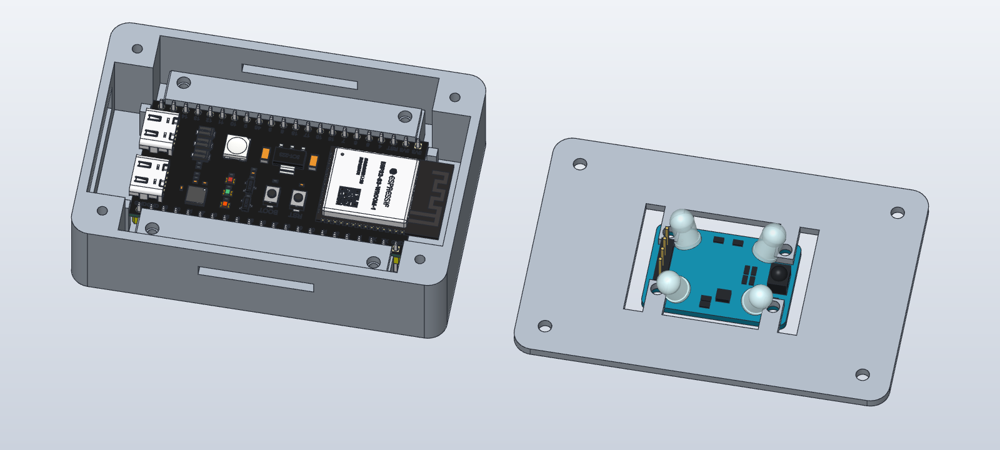
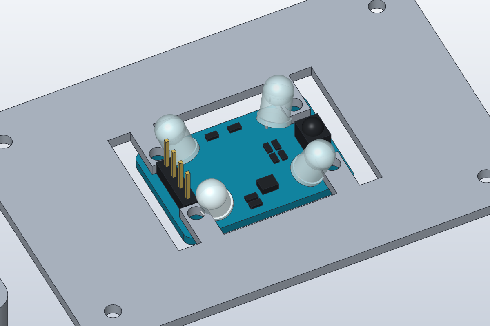

# ESP32-S3 / IR360 Enclosure Prototype

Adjustable, unverified-fit prototype for an Espressif ESP32-S3-DevKitC-1
and the Jessinie 38 kHz IR transmitter/receiver linked below.

## Preview



The base and lid are shown apart to expose the board retainers and IR opening.
Both electronics models are non-print references; hardware fit remains unverified.

## IR Module Reference

| Recreated model beneath the lid | Original module reference photo |
| --- | --- |
|  |  |

The supplied photo guided the component layout. PCB dimensions, LED tilt,
and package sizes are estimates, not measurements from the photo. See
[Recreated IR Module Reference](#recreated-ir-module-reference) for assumptions
and the possible LED-base clearance issue at the lid mounting fingers.

## Files

- [Editable SolidCraft design](esp32_s3_ir360_prototype.solidcraft)
- [Base STL](base.stl)
- [ESP32 retaining bar STL, print two](esp_retainer.stl)
- [Lid with IR through-window STL](lid_ir_deck.stl)
- [STEP, enclosure and retainers in print layout](esp32_s3_ir360_prototype.step)
- [Preview](preview.png)
- [Assembly with ESP32 reference, editable JSON](esp32_s3_ir360_with_reference.json)
- [Reference assembly preview](reference_preview.png)
- [Recreated IR module close-up](ir_reference_preview.png)
- [Recreated IR module STEP, reference only](ir_module_reference.step)
- [Downloaded YD-ESP32-S3 reference STEP](YD-ESP32-S3.step)
- [Reference repository licence](YD-ESP32-S3-LICENSE.txt)

## ESP32 Reference Assembly

Both the native SolidCraft design and the reference JSON assembly now include
the downloaded YD-ESP32-S3 model inside the base. The lid remains beside the
base for visibility. The revised base includes taller PCB supports, four
retainer screw bosses, side guides, and end stops. Two removable bars secure
the PCB edges without requiring mounting holes in the board. They are shown
installed in the editable assembly and laid out separately in the STEP export.
The imported component is named ESP32_S3_REFERENCE_NOT_FOR_PRINT. The recreated
IR component is named IR360_REFERENCE_ESTIMATED_NOT_FOR_PRINT. Exclude both
from any print export. Open the reference JSON as a SolidCraft design, not as
a command script.

This is an approximate dual-USB-C DevKitC-clone reference, not a confirmed
model of the purple ESP32-S3 N16R8 board shown in the user's photo. Its main
PCB measures 57.15 x 27.94 x 1.02 mm including modeled surface details; the
antenna extends beyond that PCB. Do not substitute these measurements for
measurements of the actual board. The STEP includes fitted pin headers,
whereas the photo shows the headers separately.

Placement is a 90-degree world-X rotation followed by a 180-degree world-Z
rotation and translation [0, 0, 11.01]. The PCB underside is Z = 10 mm,
supported directly by the revised Z = 10 mm support pads. Reference
bounds are approximately [-29.2088, -13.975, 2.31] to
[34.815, 13.975, 14.22]. The modeled header pins clear the 2 mm floor by
0.31 mm; highest modeled components clear the lid underside by 5.78 mm.
These are geometric reference clearances, not manufacturing tolerances or
a complete interference assessment with the estimated IR reference and wiring.

Both USB-C sockets face the negative-X access opening. Their fronts are
approximately 9.79 mm behind the outside wall, so actual cable plug reach
must be checked. The reference has not been slid into the wall. A future
USB-access revision may need to move the board or recess the wall.

The imported STEP has one open-body warning and several small-detail
face-wrapping warnings. There are no failed timeline features, but this
third-party import is for visual reference rather than precision collision
or mass calculations. The PCB volume is preserved through the rigid moves
(1555.390290 mm^3). The revised Base measures 23130.812933 mm^3;
the unchanged Lid measures 6370.019247 mm^3. Each retainer measures
703.374005 mm^3. The exact interference check against the detailed imported
electronics timed out; the clearance statements here are based on measured
reference bounds, not a completed all-surfaces collision check.

## Header Clearance And Mechanical Retention

The previous pads stopped at Z = 8 mm, leaving a 2 mm unsupported gap below
the reference PCB. They now reach Z = 10 mm. Fitted reference header pins end
at Z = 2.31 mm, clearing the 2 mm floor by 0.31 mm. Longer actual pins will
require a further height/USB-clearance revision; do not force them onto the floor.

Print two copies of esp_retainer.stl. Each bar is 52 x 7 x 2 mm and has two
2.8 mm clearance holes on 46 mm centers. Four matching base bosses accept
plastic-thread-forming M2.5 x 8 mm screws in 2.1 mm pilots, 8 mm deep.
The screws go into the printed bosses, not the PCB. Bar undersides nominally
contact the PCB top at Z = 11.02 mm; tighten gently and stop if the PCB bends.

The retainers overlap the outermost 0.52 mm of the reference PCB edges.
Their inner edges are at Y = +/-13.45 mm, outside the modeled header pins
(outer pin edge +/-13.025 mm), leaving 0.425 mm lateral clearance. Check
both edges on the actual board for components, solder, and traces before
tightening. Do not clamp components or solder joints. The imported model
is not a verified model of the user's board revision.

Four side guides provide 0.28 mm nominal clearance per side. Four end stops
provide 0.25 mm nominal clearance at the main PCB ends and sit outside the
reference USB shells and antenna. Together the guides and stops limit X/Y
movement; the bars prevent lifting. No adhesive or PCB mounting holes are
required. The bars are separate from the lid, so the lid's optical opening
stays clear and the ESP32 remains retained when the lid is removed.

The reference is 27.94 mm wide with a 57.15 mm main PCB. Measure your actual
board before printing: ESP_PCB_half_L, ESP_PCB_half_W, ESP_PCB_T,
ESP_side_gap, and ESP_end_gap encode this fit. They are fixed documented
defaults, not validated adjustable ranges. Changing them requires rechecking
header, component, retainer-hole, wall, and USB clearances.

Model by David Scambell, originally published at
[GrabCAD](https://grabcad.com/library/yd-esp32-s3-1), downloaded from
[shkuznetsov/YD-ESP32-S3](https://github.com/shkuznetsov/YD-ESP32-S3) at commit
bb410449c3d5ee20096ff273d6c1081c5dd6228f. The repository publishes an MIT
licence with a manufacturer-licensing caveat and credits the original model
author. Its licence is retained alongside the unmodified STEP.

Source STEP SHA-256:
EDC0685479A0C1A91ABD1ADF4516EC2784258A58095663B3F4272A125D5CF624.

## Recreated IR Module Reference

No usable CAD model was found for the exact IR_Rec_Send_V1.1 / 303IRRECSE1
markings visible in the supplied photos. A simplified 38-body visual reference
was recreated from their component layout. It includes a blue rounded PCB,
four mounting holes, four outward-tilted IR LEDs with rounded lenses and leads,
a black receiver package, a four-pin header, and simplified component blocks.
It is included in both editable assembly formats, not the printable STLs or
the enclosure-only STEP.

The photos do not establish an accurate physical scale. The reference keeps
the previous estimated 30 x 20 mm PCB and 24 x 14 mm hole pitch, rather than
claiming new measured dimensions. Assumptions are:

| Reference item | Assumed value |
| --- | --- |
| PCB thickness / corner radius | 1.6 / 1.5 mm |
| Mounting-hole diameter | 3.2 mm |
| IR LED diameter / barrel length | 5 / 4.5 mm |
| LED center offsets from PCB center | +/-8 mm X, +/-6 mm Y |
| LED outward tilt | 25 degrees, diagonally away from center |
| Receiver body | 4 x 5 x 3.5 mm, rounded lens on top |
| Header | Four pins, 2.54 mm pitch, upright as photographed |

The PCB top is flush with the displayed lid underside at Z = 0, centered at
X = lid_X (92 mm by default). The reference envelope is approximately
[77, -10.0838, -2.6] to [107, 10.0838, 8.5034]. To place it over the base with
the lid assembled, translate it [-lid_X, 0, case_H], just like the lid.
Its lowest modeled pin is then Z = 17.4 mm and its highest lens Z = 28.5034 mm.
The standalone reference STEP retains these display-layout coordinates.

This approximate model suggests possible contact between the outward-tilted
LED bases and the remaining lid mounting fingers, and near-contact between
the header housing and those fingers. This task did not change the lid or
claim optical clearance. Verify actual component positions and package sizes
before printing; window or finger changes may be needed after measurement.

The rounded LED/receiver lenses are separate overlapping reference solids,
not watertight fused electronic packages. Leads are simplified and PCB
lead-through holes, tracks, silkscreen, solder fillets, and fine package detail
are omitted. Do not use summed reference-body volume for physical mass or
treat this visual reconstruction as a certified manufacturing model.

The PCB sketch is fully constrained. Corner rounding is authored before
placement so that changing case_L does not invalidate its edge references.
Sequential walks between the default and upper endpoints of case_L = 78..82,
IR_pitch_X = 24..26, and IR_pitch_Y = 14..16 rebuilt without errors and were
returned to defaults. The PCB stays at 905.444046 mm^3 (analytic 905.437880);
its X center moves from 92 to 96 when the case length grows by 4 mm.
New IR timeline features have no errors or warnings. Primitive measurements
agree with independent formulas within 0.02 percent, including tilted LED
cylinders. Base and lid volumes are unchanged. No expensive full interference
check against the detailed ESP32 import was attempted.

## Dimensions And Assumptions

All dimensions are millimetres.

| Item | Value | Status |
| --- | --- | --- |
| Base outside | 78 x 52 x 20 | Modeled and measured |
| Wall / floor / lid plate | 2 | Modeled |
| Exterior corner radius | 4 | Modeled |
| Closed case height, excluding IR deck | 22 | Derived |
| Maximum plastic height when assembled | 22 | Derived; IR optics protrude through the opening |
| ESP32 PCB envelope | Approximately 62.8 x 25.4 | Nominal assumption; verify actual revision |
| ESP32 support tops | Z = 10 inside base | Four PCB underside supports |
| ESP32 retention | Two removable 52 x 7 x 2 bars | Four M2.5 x 8 screws into printed bosses; no PCB holes |
| USB access, negative-X end | 26 wide x 8 high; Z = 7 to 15 | Cable and connector fit unverified |
| IR PCB | 30 x 20 | ESTIMATED, not supplied by seller |
| IR hole spacing | 24 x 14 | ESTIMATED, not supplied by seller |
| IR hole diameter | Approximately 3.2 | ESTIMATED; represented in the reference PCB |
| IR mounting | Flush beneath lid | Four 4 mm-wide fingers with 2.8 mm clearance holes |
| IR optical window envelope | 36 x 26 | Through-cut, except for the four mounting fingers |

The listing photographs show four emitters, a receiver, and four corner
mounting holes, but contain no mechanical dimensions. Its linked PDF could
not be extracted. No dimensionally verified IR model or full interference
simulation was used. Approximate ESP32 and photo-recreated IR references are
included in the editable assemblies as described above. This is not a
guaranteed-fit enclosure.

The corrected lid has a real through-window: the former solid deck, raised
guard, and raised mounting posts have been removed. Mount the IR PCB beneath
the lid, component side facing out through the opening. Four narrow mounting
fingers remain at the estimated PCB hole positions. The board is inside the
case, while the LEDs and receiver must protrude through the window. Verify
their clearance from the mounting fingers and the 2 mm lid thickness, along
with clearance to the ESP32 and wiring below. Exact component positions and
heights are not verified, so unobstructed optical coverage must be checked
with the actual module. The case is not waterproof, dustproof, or certified
for unattended installation.

## Assembly And Printing

1. Check actual IR PCB dimensions, mounting-hole pitch and diameter, header
   position, and component heights before committing to a full print.
2. Print the base, lid, and two retaining bars with their flat undersides on the bed. The lid STL
   retains its print-layout X offset; use the slicer's arrange/center command.
   PETG, 0.2 mm layers, and four perimeters are reasonable starting settings.
   Check the 26 mm USB bridge in the slicer; local supports may be needed.
3. Orient the ESP32 length along X with both USB connectors toward negative X.
   Seat the PCB on the four Z = 10 mm supports between the side guides and end
   stops. Check that supports do not contact underside components and that
   pin tails clear the floor. Fit both retaining bars over the outer PCB edges
   and secure them with four plastic-thread-forming M2.5 x 8 mm screws.
   Tighten gently without bending the PCB. Check the pin/solder clearances
   described above. Retention is mechanical; foam tape is no longer required.
4. Keep the IR wiring inside the case. The former separate wiring slot is
   absorbed into the larger optical opening. Check header and wire clearance.
5. Mount the IR PCB flush beneath the four lid fingers, with its LEDs and
   receiver facing outward through the window. Use four M2.5 through-bolts
   with washers and nuts, approximately 8 mm long for a 1.6 mm PCB; verify
   actual stack thickness and avoid contact with circuitry. The lid holes
   are 2.8 mm through-clearances, not self-tapping pilot holes. Check that
   component bodies and screw heads do not obstruct the optics. If they do,
   adjust the window or mounting fingers to measured component positions.
6. Close the lid with four suitable plastic-thread-forming M2.5 x 10 screws.
   Lid clearance holes are 2.8 mm and base pilots are 2.1 mm x 12 mm deep.
   Check a pilot-hole coupon with your material and screws; do not overtighten.

The native/JSON designs show the retaining bars installed. The STEP export
shows them in print layout: translate the north bar [0, -18.55, 11.02] and the
south bar [0, 18.55, 11.02] to assemble them. The single bar STL prints twice;
the second bar is the same part turned 180 degrees around Z.

In CAD, assemble the lid by translating it [-92, 0, 20] from the default
print layout. The general translation is [-lid_X, 0, case_H]. No locating lip
is provided; the four screws align the lid.

## Parameters And Checks

Favourite driving parameters have these tested endpoint ranges:

| Parameter | Default | Tested range |
| --- | --- | --- |
| case_L | 78 | 78 to 82 |
| IR_pitch_X | 24 | 24 to 26 |
| IR_pitch_Y | 14 | 14 to 16 |

Other driving dimensions are documented as fixed. IR_PCB_L and IR_PCB_W are
estimates that now drive only the recreated reference PCB, not the window.
IR_window_L = 36, IR_window_W = 26, and IR_tab_W = 4 are fixed dimensions.
Changing IR mounting pitches moves the clearance holes and mounting fingers,
rather than providing physical slots. Larger changes require a new clearance
and geometry check. Earlier deck features remain in the timeline, but the
final named removal and window features replace their geometry.

The original enclosure and corrected lid endpoint checks are recorded below.
The imported ESP32 carries the third-party warnings documented above. The
retention revision was checked by independent volume calculations and measured
placements; it changes the base but leaves the lid and reference placement
unchanged. New retention features reported no warnings when created.
The revised case_L = 82 endpoint rebuilt without errors and matched the
expected volume. Returning to 78 restored the default measured geometry.

| State | Analytic volume, mm^3 | Measured volume, mm^3 |
| --- | --- | --- |
| Revised base, case_L = 78 | 23130.8997 | 23130.8129 |
| Each retainer | 703.3699 | 703.3740 |
| Corrected lid, case_L = 78 | 6370.0106 | 6370.0192 |
| Revised base, case_L = 82 | 23834.8997 | 23834.8207 |
| Corrected lid, case_L = 82 | 6786.0106 | 6786.0202 |
| Corrected lid, IR_pitch_X = 26 | 6370.0106 | 6370.0192 |
| Corrected lid, IR_pitch_Y = 16 | 6338.0106 | 6338.0192 |

Differences are below 0.001 percent. The default base bounding box is
[-39, -26, 0] to [39, 26, 20]; the lid is [53, -26, 0] to [131, 26, 2].
The revised base X center of mass is approximately 0.683417; the unchanged
lid X center is 92 and its Z center is 1.
Top views were checked for the through-window and mounting fingers.
Physical fit, IR performance, and
slicer/manufacturing validation remain outstanding.

Independent volume formulas, with P = pi and L = case_L:

```text
A = 52*L - (4-P)*16
B = 48*(L-4) - (4-P)*4
Base = 20*A - 18*B + 18*(256-4*(4-P))
   + 4*P*2.5^2*8 - 4*P*1.05^2*12 - 416 - 288
   + (4*49 + 4*6*0.25 + 4*4)*(ESP_clamp_Z-2) - 4*P*1.05^2*8
Retainer = 52*7*2 - 2*P*1.4^2*2
WindowArea = IR_window_L*IR_window_W
             - 4*IR_tab_W*(IR_window_W/2 - (IR_pitch_Y-IR_tab_W)/2)
Lid = 2*A - 2*WindowArea - 8*P*1.4^2*2
```

## Sources

- [IR module listing](https://de.aliexpress.com/item/1005013021929851.html)
- [Espressif DevKitC-1 v1.1 documentation](https://docs.espressif.com/projects/esp-dev-kits/en/latest/esp32s3/esp32-s3-devkitc-1/user_guide_v1.1.html)
- [Espressif mechanical drawing](https://dl.espressif.com/dl/schematics/esp_idf/DXF_ESP32-S3-DevKitC-1_V1.1_20220429.pdf)